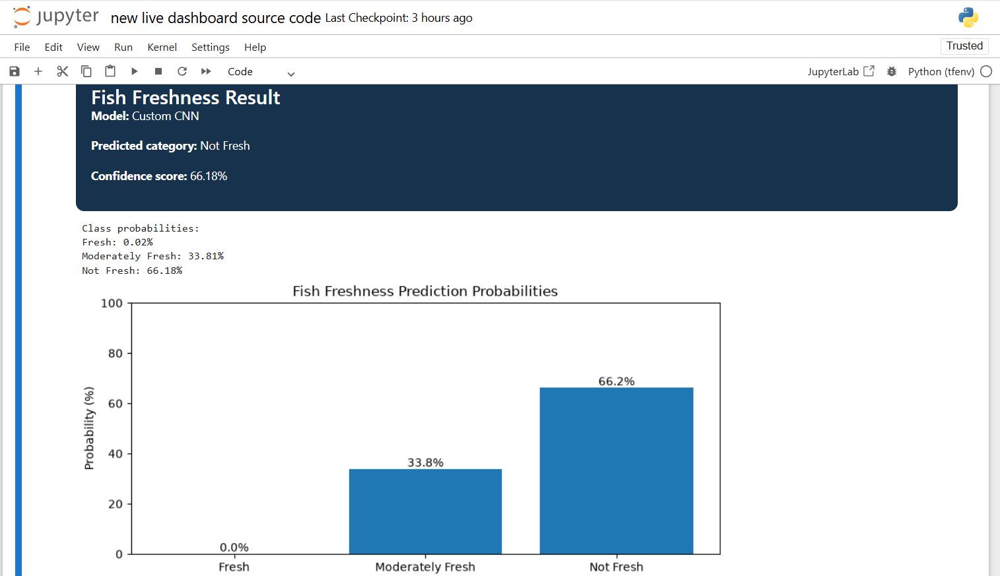

# Fish Freshness Assessment Using CNN

This project uses a Convolutional Neural Network (CNN) to classify fish freshness from images. The goal is to automate freshness detection so that fish can be evaluated quickly, consistently, and more reliably than manual inspection alone.

## Project Overview

Fish freshness is an important quality and safety factor in seafood handling and consumption. Fresh fish typically have clear eyes, bright red gills, firm flesh, shiny skin, and a mild ocean-like smell, while spoiled fish often show cloudy eyes, dull skin, soft flesh, and unpleasant odor [web:22][web:24][web:28].

This project explores an image-based approach to freshness assessment using deep learning. A CNN model is trained to learn visual patterns from fish images and classify them into freshness categories.

## Objectives

- Build a fish freshness classification model using CNN.
- Train the model on labeled fish images.
- Evaluate model performance using standard classification metrics.
- Create a simple workflow that can support quality inspection in food and seafood applications.

## Problem Statement

Manual fish freshness inspection depends on human judgment and can be inconsistent. The objective of this project is to automatically classify fish freshness from images using a CNN-based deep learning model.

## Why This Matters

Freshness detection is useful in:
- seafood supply chains,
- market inspection,
- food safety monitoring,
- retail quality control,
- and consumer decision support.

A visual model cannot replace all sensory inspection, but it can help identify likely freshness states faster and more consistently [web:24][web:36].

## Dataset

The dataset used in this project contains labeled fish images for freshness classification.

### Expected Freshness Indicators
The model is inspired by standard visual freshness cues such as:
- clear and bulging eyes,
- bright red gills,
- shiny skin and scales,
- firm flesh,
- and absence of foul odor in real-world inspection [web:22][web:24][web:28].

### Dataset Structure
A typical dataset structure may look like this:

```bash
dataset/
├── fresh/
├── less_fresh/
└── spoiled/
```

or

```bash
dataset/
├── train/
│   ├── fresh/
│   ├── less_fresh/
│   └── spoiled/
├── validation/
│   ├── fresh/
│   ├── less_fresh/
│   └── spoiled/
└── test/
    ├── fresh/
    ├── less_fresh/
    └── spoiled/
```

## Methodology

The project follows these steps:

1. Collect and organize fish images.
2. Preprocess images by resizing and normalization.
3. Split the dataset into training, validation, and test sets.
4. Build a CNN model for image classification.
5. Train the model on labeled freshness categories.
6. Evaluate the model using accuracy, precision, recall, and F1-score.
7. Visualize training loss and accuracy curves.
8. Test the model on unseen fish images.

## Model Architecture

The CNN model may include:
- convolution layers,
- max pooling layers,
## Latest Project Update — 12 October 2026

The Fish Freshness Assessment project now includes a live image prediction dashboard using trained deep learning models.

### New Dashboard Features

- Upload a fish image directly from the dashboard.
- Select between the Custom CNN and MobileNetV2 models.
- Predict one of three freshness categories:
  - **C1 — Fresh**
  - **C2 — Moderately Fresh**
  - **C3 — Not Fresh**
- Display the predicted category and model confidence score.
- Visualize class probabilities using a bar chart.

### How to Run the Live Dashboard

1. Install Python and the required project dependencies.
2. Open Jupyter Notebook in the project environment.
3. Open `fish_freshness_live_dashboard.ipynb`.
4. Run the notebook cells in order.
5. Select a fish image from your computer.
6. Choose a model and click **Test Prediction**.
7. Review the predicted category, confidence score, and probability chart.

### Models Used

- Custom Convolutional Neural Network (CNN)
- MobileNetV2 transfer-learning model

### Important Note

The model's confidence score represents its predicted probability and does not guarantee the actual freshness or food safety of the fish.

## Live Dashboard Preview

The dashboard allows users to upload a fish image, select a trained model, view the predicted freshness category, and inspect the class probability chart.


## Model Evaluation Results

The models were evaluated on a test dataset containing 240 images, with 80 images in each class: Fresh, Moderately Fresh, and Not Fresh.

### Performance Comparison

| Metric | Custom CNN | MobileNetV2 |
|---|---:|---:|
| Test Accuracy | 38.75% | 92.50% |
| Macro F1-score | 0.2837 | 0.9243 |
| Correct Predictions | 93/240 | 222/240 |

### MobileNetV2 Classification Results

| Class | Precision | Recall | F1-score | Support |
|---|---:|---:|---:|---:|
| Fresh (C1) | 0.9412 | 1.0000 | 0.9697 | 80 |
| Moderately Fresh (C2) | 0.9231 | 0.9000 | 0.9114 | 80 |
| Not Fresh (C3) | 0.9091 | 0.8750 | 0.8917 | 80 |

### Evaluation Figures

The `figures/` directory contains the model comparison chart, confusion matrices, accuracy and loss curves, ROC curves, and classification reports.

- `figures/four_model_comparison.png` — model performance comparison
- `figures/mobilenetv2_final_confusion_matrix.png` — MobileNetV2 confusion matrix
- `figures/mobilenetv2_curves.png` — MobileNetV2 training curves
- `figures/mobilenetv2_roc.png` — MobileNetV2 ROC curve

### Discussion

MobileNetV2 achieved 92.50% test accuracy and a macro F1-score of 0.9243, outperforming the custom CNN on this dataset. It correctly classified 222 of the 240 test images. Further testing on images collected under different conditions is needed before real-world use. Model predictions do not guarantee fish freshness or food safety.